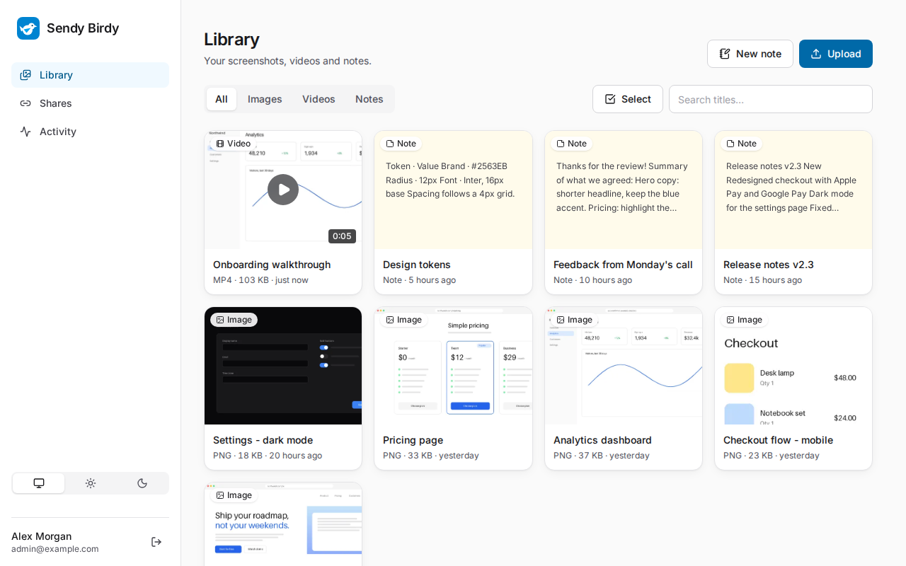
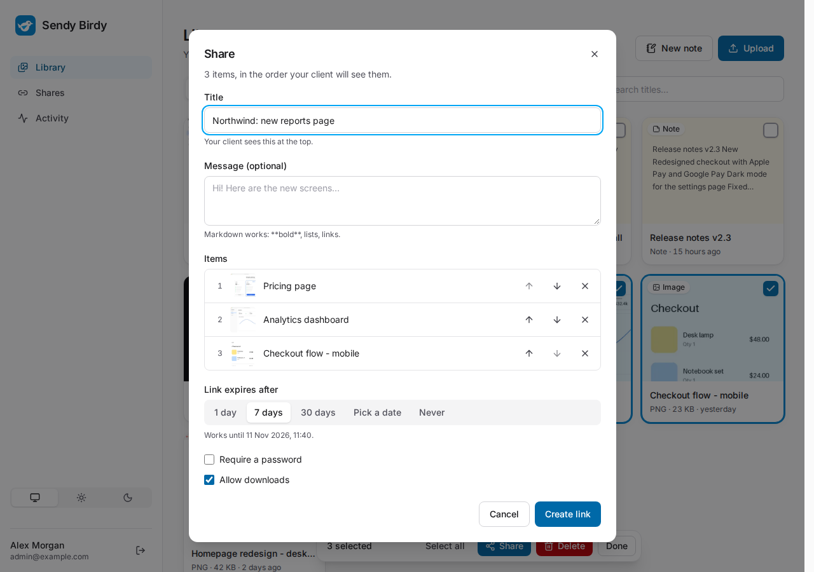
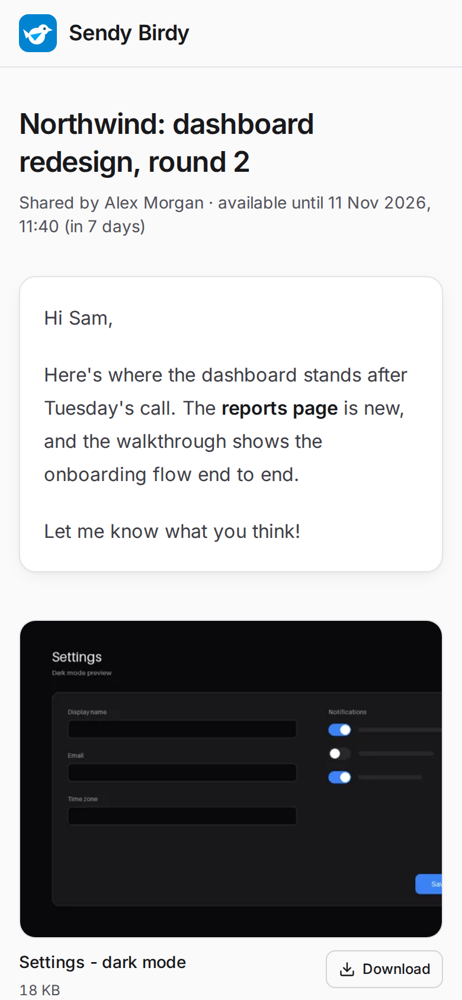
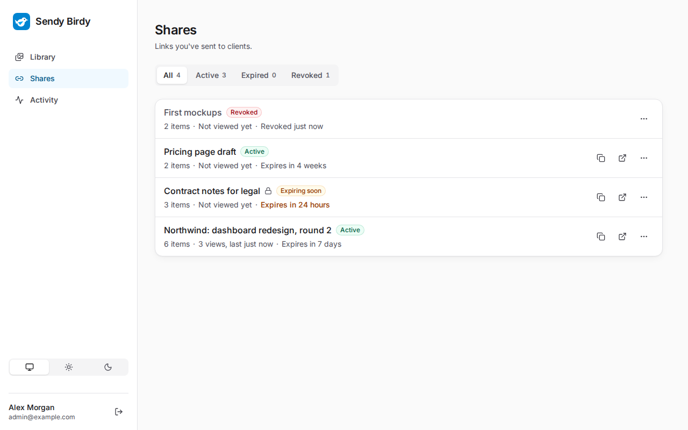
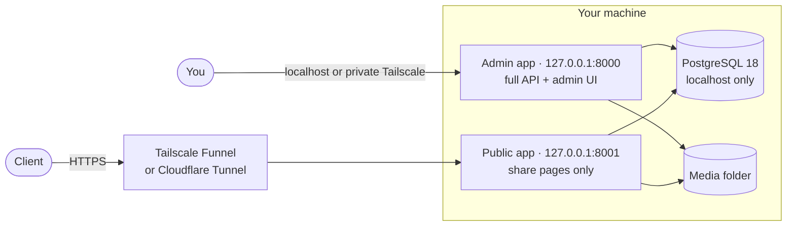

# Sendy Birdy

**Send screenshots, demo videos and notes to clients through private links that expire.**
Sendy Birdy runs on your own machine. Your files stay there, there's nothing to pay for, and your clients don't need an account. They just open a link.

<picture>
  <source media="(prefers-color-scheme: dark)" srcset="docs/screenshots/library-dark.png">
  
</picture>

## How it works

1. **Upload** screenshots and screen recordings (drag and drop, or paste straight from the clipboard), or write a note in Markdown.
2. **Share:** pick some items, give the link a title, a message and an expiry date, and optionally a password.
3. **Send the link.** Your client opens it on any phone or computer. You see when it was viewed, and you can revoke it at any time.

| Share a selection | What your client sees | Every link in one place |
|---|---|---|
| <picture><source media="(prefers-color-scheme: dark)" srcset="docs/screenshots/share-dialog-dark.png"></picture> | <picture><source media="(prefers-color-scheme: dark)" srcset="docs/screenshots/share-page-dark.png"></picture> | <picture><source media="(prefers-color-scheme: dark)" srcset="docs/screenshots/shares-dark.png"></picture> |

All screenshots use the built-in demo data (`make seed-demo`), in light or dark mode to match your GitHub theme.

## Features

- **Library** of images (PNG, JPEG, WebP, GIF), videos (MP4, WebM, MOV) and Markdown notes, with search, filters, a full-screen viewer, rename, multi-select and bulk delete.
- **Uploads that don't get in the way:** several at once with progress, cancel and retry, and they keep going while you move around the app.
- **Share links** with a title and message, the order you choose, an expiry date (or none), an optional password and a downloads on/off switch. Edit, extend or revoke them later.
- **A share page made for clients:** fast on a phone on mobile data, light and dark mode, no sign-up, and no requests to anyone else's servers.
- **Activity log** of views, downloads, failed unlocks and sign-ins, with each visitor's IP address and browser. Entries are deleted automatically after 90 days.
- **Privacy by default:** GPS and other EXIF data is stripped from photos on upload, and share pages are never indexed by search engines.
- **Backups** of the database and every file with one command, and a restore that checks every file before it changes anything.
- **Accessible:** works with the keyboard alone and with screen readers, checked against WCAG 2.2 AA in both themes.

## Architecture



The same code runs as two processes. The **admin app** has everything and is reachable only from your own devices. The **public app** knows nothing but share links: the admin routes aren't hidden there, they don't exist. Only the public app is put on the internet, through a tunnel, so there's no port forwarding and no public IP address. FastAPI serves the built React app, so each process is a single origin with no CORS.

## Security model

- **Only you can upload.** There's one admin account, created from the command line, and no sign-up page.
- **Sign-in:** Argon2id password hashes, a random session token in an `HttpOnly`, `SameSite=Strict` cookie (only its hash is stored), rate limiting per IP address, and a required header on every request that changes data (CSRF).
- **Share links** use 128-bit random tokens. Every request, file by file, re-checks that the link still exists, hasn't expired and isn't revoked, so revoking works instantly.
- **Passwords on links** are hashed with Argon2id and rate-limited per visitor and per link. Unlocking sets a signed cookie scoped to that one link; changing the password signs everyone out of it.
- **Uploads** are identified from their content, never their name or browser-reported type, against an allowlist (no SVG or HTML). They're stored under random IDs, and the size limit is enforced while streaming. Images over 100 megapixels (decompression bombs) are refused.
- **Responses** carry a strict Content-Security-Policy (no inline scripts), `nosniff`, `frame-ancestors 'none'`, `Referrer-Policy: no-referrer` and HSTS over HTTPS. Files are served with `sandbox`. Share pages are `noindex` and `Cache-Control: private`.
- **Database:** PostgreSQL listens on localhost only, and the app connects as a role that isn't a superuser.
- **Known limit:** turning downloads off removes the download buttons, but it can't stop anyone from saving what they can see.

Found a vulnerability? Please report it privately: see [SECURITY.md](SECURITY.md).

## Quick start

To try it on your machine you need [uv](https://docs.astral.sh/uv/), Node.js 22.12 or newer, PostgreSQL 18 running locally, `make`, and optionally ffmpeg (for video posters and durations).

```bash
make install       # dependencies, plus a .env with a random SECRET_KEY
make db-setup      # the database role and databases (asks for your sudo password)
make db-migrate    # the database tables
make create-admin  # your admin account (prompts for email, name and password)
make seed-demo     # optional: demo screenshots, notes and a video
make dev           # the API and the frontend together; Ctrl+C stops both
```

Open <http://localhost:5173> and sign in. API docs are at <http://127.0.0.1:8000/api/docs>.

Or with Docker, without installing anything else:

```bash
docker compose up -d --build
docker compose run --rm admin python -m app.cli create-admin
```

The admin app is then at <http://localhost:8000> and share links at <http://localhost:8001>.

**To use it with real clients**, follow the [self-hosting guide](docs/self-hosting.md): both apps as services that start on boot, only the public app exposed through Tailscale Funnel (free, no domain needed) or Cloudflare Tunnel, the admin app over your private Tailscale network, nightly backups and updates.

## Commands

| Command | What it does |
|---|---|
| `make install` | Install backend and frontend dependencies; create `.env` if it doesn't exist |
| `make db-setup` | Create the `sendy` PostgreSQL role and databases, and add their URLs to `.env` |
| `make db-migrate` | Apply database migrations |
| `make create-admin` | Create the admin account. Change it later with `uv run python -m app.cli update-admin` (from `backend/`) |
| `make seed-demo` | Fill an empty library with demo screenshots, notes and a short video |
| `make dev` | Run the API (port 8000) and the frontend (port 5173) together |
| `make build` / `make start` | Build the frontend, then run both production apps (admin on 8000, public on 8001) |
| `make backup` | Back up the database and media into `./backups` |
| `make check` | Run every linter, type check and test |
| `make e2e` | Run the browser tests (Playwright and axe) on a fresh demo library |
| `make screenshots` | Retake the screenshots in this README |
| `make fmt` | Fix lint issues where possible and format all code |

Run `make` on its own to list them all.

## Tech stack

| | |
|---|---|
| **Backend** | Python 3.12, FastAPI, Pydantic v2, async SQLAlchemy 2 + asyncpg, Alembic, Pillow, ffmpeg |
| **Database** | PostgreSQL 18 |
| **Frontend** | React 19, TypeScript, Vite, Tailwind CSS v4, TanStack Query, React Router, `openapi-fetch` (types generated from the API's OpenAPI schema) |
| **Testing** | pytest, Vitest + Testing Library, Playwright + axe |
| **Tooling** | uv, Ruff, ESLint, Prettier, GitHub Actions, Docker |

## License

[MIT](LICENSE)
